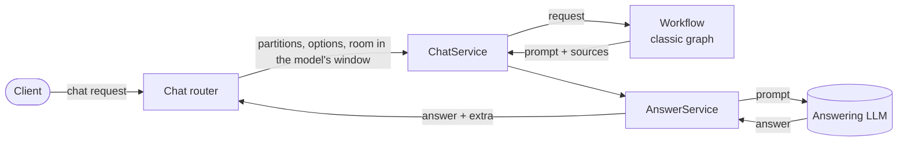
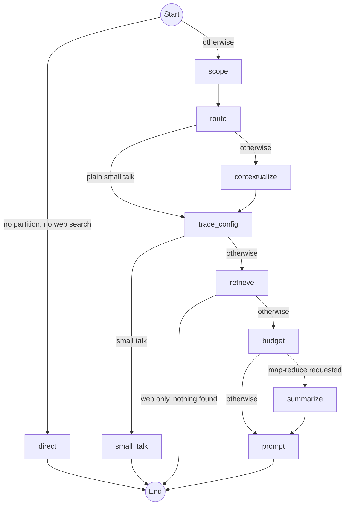
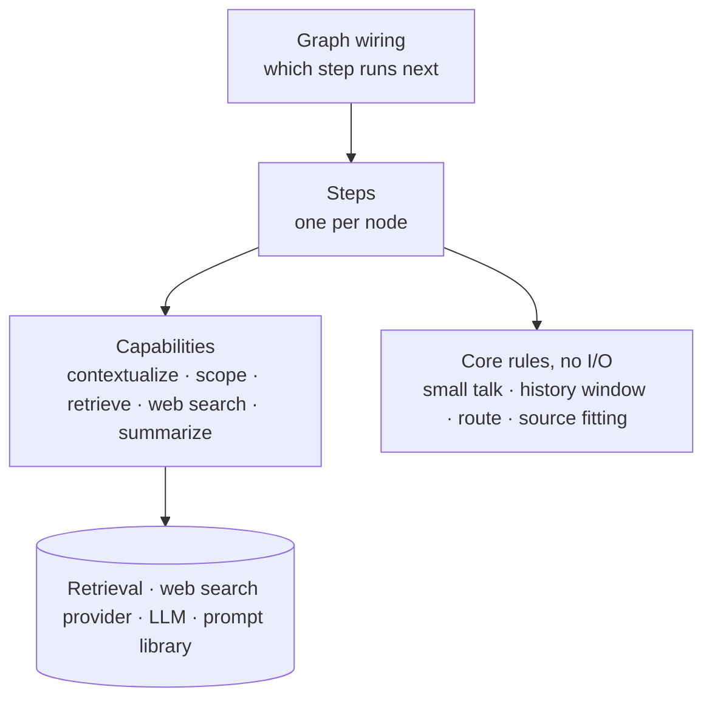

A chat request (`POST /v1/chat/completions`) goes through three parts:

- a **workflow**, which finds the sources and writes the prompt;
- the **answering step**, which calls the model;
- the **chat service**, which picks the workflow and hands what it prepared to the answering step.

- **Chat router.** Resolves the model name to the partitions the user can access, and checks that the request fits in the answering model's context window. It does not search anything.
- **ChatService.** Resolves the answering LLM (the partition's `chat_llm`, else the default) and picks a workflow. Every chat request runs a workflow, a request with nothing to search included.
- **Workflow.** Gets the request and returns a *prepared answer*: the messages to send to the model, the sources shown to it and the trace. It never produces the answer itself. `classic` is the only workflow today.
- **AnswerService.** The same for streamed and non-streamed answers. It calls the model, strips the `[Sources: N]` tag, keeps the cited sources, retries an empty answer and builds `extra`.

## The classic workflow

The classic workflow is a [LangGraph](https://langchain-ai.github.io/langgraph/) graph. It is compiled once when the API starts and runs for every chat request.

| Step | What it does | Stops the request |
|---|---|---|
| `direct` | Nothing to search: the model gets the messages as the client sent them | — |
| `scope` | Keeps the last `chat_history_depth` messages and the client's system prompt. Narrows the partitions to the requested workspace or attachments | 422 when no user message is left, 404 for an unknown workspace |
| `route` | Decides whether the last message is small talk (a greeting, thanks, a question about the assistant), and whether the request forces a search (`require_retrieval`, `websearch`, `use_map_reduce`, attachments) | — |
| `contextualize` | Rewrites the conversation into standalone search queries, with their date filters and date order. With `bypass_query_contextualization`, the last message is the query as it is | — |
| `trace_config` | Records the retrieval plan and the configuration fingerprint, when the request asks for the retrieval trace | — |
| `small_talk` | Writes a short casual-answer prompt, with no search | 413 when the conversation does not fit in the window |
| `retrieve` | Searches the documents, the web, or both at the same time | — |
| `budget` | Picks the answer template and works out how much room the window leaves for sources | 413 when the conversation alone does not fit |
| `summarize` | Map-reduce: keeps the relevant documents and replaces each with its summary. Runs only when the request asks for it | — |
| `prompt` | Fits as many sources as the room takes, numbered documents first, then web results. Orders the documents by date when the question asks for "the last" or "the first", then writes the prompt | — |

Typical paths:

| Request | Steps |
|---|---|
| The model itself, no web search | `direct` |
| "Thanks" to a partition | `scope` → `route` → `trace_config` → `small_talk` |
| A question to a partition | `scope` → `route` → `contextualize` → `trace_config` → `retrieve` → `budget` → `prompt` |
| The same, with `use_map_reduce` | … → `budget` → `summarize` → `prompt` |
| Web search only, no result | … → `retrieve`, then the model answers without sources |

A greeting stops being small talk when the request forces a search: it then takes the question's path.

## Layers

- **Graph wiring.** The edges between the steps, and nothing else. It is the only code that imports LangGraph, and the layer import check fails the build if anything else does.
- **Steps.** Plain functions that read the request's state and return what they change. They have no LangGraph code, so they can be tested without a graph.
- **Capabilities.** Each one does a single job and knows nothing about the graph. The completions endpoint uses some of them too.
- **Core rules.** Decisions made without I/O, such as whether a message is small talk, how much history to keep, or which sources fit.
- Everything is built and wired in one place at startup (`di/`), and the graph is compiled there.

## Outside the graph

- **`POST /v1/completions`** follows one fixed path. The contextualizer rewrites the prompt into queries, then the documents are searched, the sources fitted and the prompt written. It has no history, no small talk and no web search. The search is skipped when the contextualizer finds that the prompt needs none. It shares the contextualizer, the retriever and the source fitting with the chat workflow.
- **`/search`** is a raw search the caller controls. It does not run a workflow.

## Observing a run

With `LOG_LEVEL=DEBUG`, each step logs one `Chat step` line, such as `graph=classic | step=retrieve | queries=2`. The request's `request_id` is attached, so a request's path can be read from the logs. With `metadata.include_retrieval_trace`, the response's `extra.retrieval_trace` reports what the search did: the queries, the stages and the configuration fingerprint.
